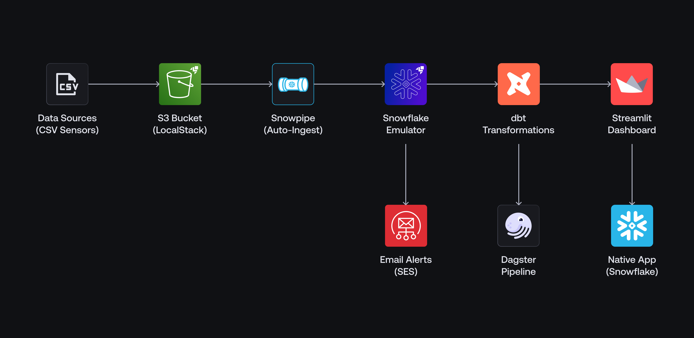

# Smart Factory Monitoring App

This project showcases a comprehensive smart factory monitoring application specifically designed to demonstrate **LocalStack for Snowflake** capabilities for local data cloud development, debugging, and testing throughout the entire software development lifecycle (SDLC).

This application showcases the full spectrum of **LocalStack for Snowflake** features, such as:

- Emulating a local Snowflake environment with databases, schemas, tables, and more.
- Utilizing S3 service for automated data ingestion with Snowpipe integration.
- Implementing dbt transformations for data quality and processing.
- Building interactive dashboards with Streamlit and Snowflake Native Apps.
- Orchestrating data transformations in an automated pipeline with Dagster.
- Implementing comprehensive data & integration testing with pytest and dbt tests.
- Using GitHub Actions for continuous integration to ensure automated testing.
- Adding real-time alerting with a Python User-Defined Function (UDFs) and Snowflake Tasks.
- Showcasing Zero-Copy Cloning for instant data recovery scenarios in case of data loss.

The application serves as a complete reference implementation for developing Snowflake data solutions locally, enabling real-time monitoring of factory machines, automated data ingestion, quality testing, and predictive maintenance alerts—all running entirely on your local machine through LocalStack's Snowflake emulator.

## Architecture

The application implements a modern data pipeline architecture showcasing a realistic smart factory scenario:



## Prerequisites

- A valid [LocalStack for Snowflake license](https://localstack.cloud/pricing). Your license provides a [`LOCALSTACK_AUTH_TOKEN`](https://docs.localstack.cloud/getting-started/auth-token/) to activate LocalStack.
- [Docker](https://docs.docker.com/get-docker/) with [Docker Compose](https://docs.docker.com/compose/install/)
- [`lstk`](https://docs.localstack.cloud/aws/developer-tools/running-localstack/lstk/) (only for Cloud Pods)
- [AWS CLI](https://docs.localstack.cloud/user-guide/integrations/aws-cli/) with the [`awslocal` wrapper](https://docs.localstack.cloud/user-guide/integrations/aws-cli/#localstack-aws-cli-awslocal).
- [Snowflake CLI](https://docs.snowflake.com/developer-guide/snowflake-cli/index) with a [`localstack` connection profile](https://snowflake.localstack.cloud/user-guide/integrations/snow-cli/) on port 4567 (see [Deployment](#deployment)).
- [Python](https://www.python.org/downloads/) 3.10+ & [`pip`](https://pip.pypa.io/en/stable/installation/)
- [`make`](https://www.gnu.org/software/make/) (**optional**, but recommended for running the sample application)

## Installation

To run the sample application, you need to install the required dependencies.

First, clone the repository:

```bash
git clone https://github.com/localstack-samples/snowflake-smart-factory-app.git
```

Then, navigate to the project directory:

```bash
cd snowflake-smart-factory-app
```

Next, install the project dependencies by running the following command:

```bash
make install
```

## Deployment

The sample runs two containers with Docker Compose: LocalStack for AWS (S3, SQS, SES) on port 4566, and the LocalStack Snowflake emulator (`localstack/snowflake-next`) on port 4567. The emulator reads the external stage from LocalStack's S3.

Start both with your `LOCALSTACK_AUTH_TOKEN`:

```bash
export LOCALSTACK_AUTH_TOKEN=<your-auth-token>
make start
```

Point the Snowflake CLI `localstack` connection at the emulator:

```bash
snow connection add --connection-name localstack \
  --user test --password test --account test --role test \
  --warehouse test --database test --schema test \
  --host snowflake.localhost.localstack.cloud --port 4567 --no-interactive
```

To deploy the sample application, run the following command:

```bash
make deploy
```

This will:

- Setup Snowflake database, tables, and Snowpipe
- Setup S3 bucket with event notifications
- Upload sample sensor data (`data/sensor_data_batch_1.csv`)
- Run dbt transformations to process the data

> [!NOTE]
> The Native App step does not run on the Snowflake emulator yet: it does not support application packages (`CREATE APPLICATION PACKAGE`, `SHOW APPLICATION PACKAGES`), so `make app` fails and CI skips it. The rest of the sample runs on it.

You can also run the following command to deploy the Native app:

```bash
make app
```

The output will be similar to the following:

```bash
[●] Deployed on LocalStack
 └─ URL: https://snowflake.localhost.localstack.cloud:4567/apps/test/test/FACTORY_APP_{USER}/
```

The dashboard provides:

- Real-time machine health monitoring
- Interactive sensor data visualizations
- Predictive maintenance recommendations
- Anomaly detection and alerting

## Testing

You can run full end-to-end integration tests using the following command:

```bash
make test
```

This executes:

- **Machine Health Tests**: Verifies health metrics calculations and thresholds
- **Snowpipe Integration Tests**: Tests automated data ingestion workflows

## Use Cases

### Pipeline Orchestration

To run automated dbt transformations on new data, you can launch a Dagster pipeline:

```bash
make pipeline
```

This will:

- Setup a pipeline monitoring dashboard
- Create a S3 sensor to monitor new data
- Trigger dbt transformations on new data

To trigger dbt transformations on new data, you can run the following command:

```bash
make upload LATEST=true
```

This will upload the latest sensor data batch (`data/sensor_data_batch_2.csv`) to the S3 bucket. The Dagster pipeline will automatically detect the new data and trigger the dbt transformations.

To generate new sensor data, you can run the following command:

```bash
make generate
```

### Real-Time Alerting

To set up automated email alerts for critical machine conditions, you can run the following command:

```bash
make alerts
```

This will:

- Create a Python UDF to send email alerts with SES integration
- Create a Snowflake Task to trigger the UDF every 30 seconds
- Create a Snowflake View to query critical machine data
- Send HTML emails for critical machine conditions

In 30 seconds, you can query the SES developer endpoint to see the alert email:

```bash
curl -s http://localhost.localstack.cloud:4566/_aws/ses
```

You can also use the [Mailhog extension](https://github.com/localstack/localstack-extensions/tree/main/mailhog) to view the alert email via a user-friendly interface.

### Data Recovery with Zero-Copy Cloning

To demonstrate instant data recovery capabilities, you can run the following command:

```bash
snow sql -f solutions/data_recovery_clones.sql -c localstack
```

This showcases:

- Instant table cloning without data duplication
- Point-in-time recovery scenarios
- Disaster recovery best practices

### Test Data Management with Cloud Pods

Cloud Pods enable persistent state snapshots of your LocalStack instance that can be easily stored, versioned, shared, and restored across development teams and CI/CD environments.

The Snowflake state (databases, tables, loaded sensor data and dbt models) lives in the Snowflake emulator container, so save and load the pod there with `lstk`.

To save a Cloud Pod, run the following command:

```bash
lstk --endpoint-url http://localhost.localstack.cloud:4567 save pod:smart-factory-app
```

To load a Cloud Pod, run the following command:

```bash
# Restore the saved state in a fresh Snowflake emulator
lstk --endpoint-url http://localhost.localstack.cloud:4567 load pod:smart-factory-app
```

The key advantages are:

- Pre-seed CI environments with complex factory data and Snowflake schemas in seconds
- Share identical test scenarios across development teams for consistent debugging
- Guarantee the same test data state across different pipeline runs and environments  
- Capture problematic states for collaborative debugging and issue reproduction

For automated Cloud Pods management in CI/CD pipelines, check out the sample workflow in [`.github/workflows/cloud-pods.yml`](.github/workflows/cloud-pods.yml).

## License

This project is licensed under the [Apache License 2.0](LICENSE).
